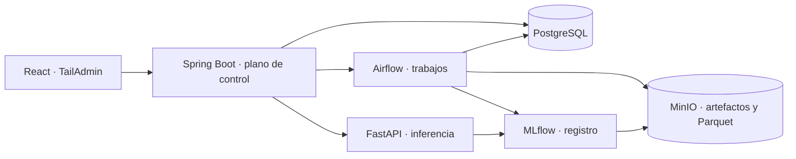

# Arquitectura de RetailOps

## Alcance y estado real

Aplicación local-first en un único equipo. La Fase 0 contiene tres procesos independientes: React/TailAdmin, Spring Boot con Actuator y FastAPI con `/health`. Hay configuración de proxy Vite `/api` → Spring con eliminación del prefijo. Actualmente existe el bootstrap 2013–2014 en PostgreSQL/MinIO. F3 incorpora integración local de lectura React → Spring → FastAPI, estado Airflow con viewer y demo candidata explícita; no hay autenticación comercial de aplicación; F1-06 incorpora un modelo candidato global y su inferencia; F1-02 añadió almacenamiento y F1-03 lo cargó/publicó.

F1-01 añade `pipelines/ingestion/retailops_profiling`: inspección reproducible de CSV en bloques con Python 3.12/uv y SQLite temporal de la biblioteca estándar para agregación, unicidad y relaciones. Sus salidas son informes y un manifiesto descriptivo sin liberación. No se conecta a los servicios ni crea tablas PostgreSQL, particiones o capas transformadas. El perfil de toda la fuente no es una estadística autorizada para entrenar al corte inicial.

F1-02 incorpora Compose modular con PostgreSQL 18.7 y MinIO compilado desde fuentes oficiales fijadas. Flyway usa dos propietarios e historiales: control por Spring Boot y esquemas de datos por ingeniería de datos mediante un runner único de mantenimiento optativo. El entrenador solo puede leer vistas `training` con predicados de liberación impuestos por el servidor y el bucket released; no puede consultar Silver ni cuarentena. Ese fue el estado al cerrar F1-02; F1-03 ejecutó el bootstrap descrito a continuación. Contratos y modelo detallados en [DATA_STORAGE.md](DATA_STORAGE.md), operación en [infra/docker/README.md](../infra/docker/README.md).

F1-03 incorpora un pipeline Python 3.12 con extractor separado, RAW mensual preservado, BRONZE Parquet decimal, COPY transaccional Silver e inventario de publicación recuperable. Control V2 distingue STAGING/AUTHORIZED/COMPLETE; datos V2 exige COMPLETE en vistas. La autorización SQL precede a copias S3 y el corte solo avanza en la transacción de finalización. No hay transacción distribuida ni disponibilidad atómica de todos los objetos. Bootstrap completado: 1 297 296 ventas, corte 2014-12-31; auxiliares sin disponibilidad probada retenidos en cuarentena/Silver restringido. [Contrato y operación](BOOTSTRAP.md), [evidencia](BOOTSTRAP_EVIDENCE.json).

F1-04A incorpora un proyecto uv independiente para JupyterLab/pandas/matplotlib y notebooks sobre vistas training con rol trainer, transacciones read-only, período fijo y límites de consultas. Los resultados son EDA retrospectivo, no tablas GOLD ni parámetros de un modelo. No se leen CSV/Silver o auxiliares restringidos. [Hallazgos](EDA_FINDINGS.md), [operación](../notebooks/README.md).

Las integraciones de negocio, ingestas mensuales y despliegues posteriores del resto del documento siguen siendo arquitectura objetivo. MinIO comunitario está archivado: se conserva el stack solicitado con compilación local fijada y limitaciones explícitas de mantenimiento.

## Componentes y comunicación prevista

- Spring Boot gestiona usuarios, ADMIN/ANALYST, autorización, solicitudes de ingesta/entrenamiento, aprobaciones, despliegues, rollback, auditoría e historial. No transforma CSV.
- FastAPI carga modelos versionados, expone inferencia y metadatos del activo. No replica administración.
- Airflow orquesta ETL, calidad, construcción de features y evaluación; el entrenamiento será un flujo separado de la ingesta.
- MLflow conserva parámetros, métricas, experimentos y versiones/referencias a artefactos. No reemplaza auditorías de negocio.
- PostgreSQL conserva SILVER/GOLD y metadatos administrativos según esquemas que se definirán en Fase 1/2. MinIO conserva objetos y artefactos.
- Los contratos HTTP, timeouts, reintentos y autenticación interna se concretarán al implementar cada conexión. Las URLs serán configuración, no constantes de entorno en código.

## Flujo y temporalidad de datos

SOURCE: CSV originales inmutables locales, nunca publicados. RAW: particiones mensuales inmutables en MinIO (`raw/sales/year=2015/month=01/sales.csv`). BRONZE: Parquet tipado con lote, trazabilidad y validación/checksum. SILVER: PostgreSQL, ventas decimales, promociones con su semántica original, clave natural `(date, store_nbr, family)` y restricciones. GOLD: agregados y features con fecha de disponibilidad explícita.

Bootstrap de 2013–2014 establece el corte activo en 2014-12-31 únicamente al terminar con éxito. Se libera enero de 2015 y luego un mes cronológico por ejecución hasta agosto de 2017. Las particiones futuras no son consumibles antes de su liberación. El último mes puede ser parcial.

DAG previsto `retailops_monthly_ingestion`: resolver lote → extraer datos autorizados → validar RAW → BRONZE → SILVER → GOLD → evaluar predicciones previas → finalizar resultado. Estados PENDING/RUNNING/SUCCEEDED/FAILED; correlación de solicitud, ejecución Airflow y lote. Persistir tiempos, errores y recuentos. Reintentos idempotentes, exclusión de ejecuciones incompatibles y avance del corte solo tras éxito coherente. No registrar éxito tras un fallo. La estrategia transaccional y recuperación se diseñará en su fase.

## Entrenamiento e inferencia

Entrenar candidatos con histórico liberado; evaluar mediante particiones temporales. Lags y ventanas calculados únicamente con observaciones disponibles al emitir la predicción. En un horizonte de siete días, especificar por variable si se conoce al emitir o se estima recursivamente; evitar fuga dentro del horizonte, además del corte global. No utilizar ventas, transacciones ni promociones futuras desconocidas, ni agregados posteriores al corte. Los feriados también deben respetar su disponibilidad temporal.

Cada predicción persistirá versión de modelo, emisión histórica, objetivo, tienda, familia, venta predicha, observación real cuando exista y timestamp real de ejecución. Tras una ingesta se evaluarán las predicciones guardadas; nunca regenerarlas retrospectivamente para aparentar precisión. Ejemplo: corte 2014-12-31, objetivos 2015-01-01 a 2015-01-07; evaluar al ingerir enero. Backtests semanales internos son una extensión posterior.

Ingesta, entrenamiento, comparación con el activo, aprobación, despliegue y rollback son acciones independientes. Solo promover modelos aprobados y conservar referencias para restaurar una versión anterior aprobada. Ciclo de software separado del ciclo de modelos.

## Seguridad y límites

Fase 0: sin autenticación; servicios enlazados por defecto a loopback; no usar datos sensibles ni exponer a una red compartida. No hay usuarios ni credenciales de muestra.

Propuesta pendiente para Fase 2: sesión de servidor de Spring Security con cookie HttpOnly, SameSite y protección CSRF, preferentemente mismo origen con React; contraseñas con hash adaptativo y sin registro público. Debe aprobarse y concretarse antes de implementarla, incluyendo HTTPS si se abandona loopback. Limitaciones: la máquina y su usuario local siguen siendo parte de la confianza; no es identidad federada ni seguridad multiusuario de producción.

ADMIN podrá ingerir, entrenar, aprobar/desplegar, revertir y consultar auditorías e información comercial. ANALYST tendrá lectura de ventas, predicciones, métricas e historial. Autorizar en backend, no solo en botones.

Variables de entorno para configuración; ningún secreto en VITE_*, repositorio o logs. Compose utilizará secretos apropiados al desplegarse. En Kubernetes, ConfigMaps para configuración y Secrets para credenciales; Secrets no equivale por sí solo a un gestor de secretos cifrado/administrado. Acceso a MLflow, MinIO y Airflow quedará interno y con controles al implementar infraestructura.

## Ejecución y recuperación

Primero Docker Compose; después K3s local de un solo nodo con Helm. No hay alta disponibilidad ni disponibilidad 24/7. El apagado del equipo es esperado. Persistencia, backups y restauración verificables se diseñarán progresivamente. CI externa no debe asumir acceso permanente al K3s local.

Prometheus, Grafana y Loki se incorporarán para métricas técnicas, datos, modelos y pipelines, logs correlacionados, alertas, SLOs de operación local y runbooks. Las probes actuales comprueban procesos; no prueban datos, modelos ni infraestructura futura.

## GOLD implementado en F1-04B

PostgreSQL conserva features point-in-time y etiquetas separadas, versionadas por snapshot. Transformación Python/SQL con ingestor sobre training.sales, bloques mensuales transaccionales y comparación completa en reejecución. El trainer solo recibe vistas training.gold_features/gold_labels. Control/data V3 mantienen propietarios Flyway y bloquean el estado durante cada bloque. Corte 2014-12-31, horizontes 1..7, calendario futuro permitido sin etiquetas futuras. [Contrato, semántica y límites](FEATURE_ENGINEERING.md). Ese fue el estado al cerrar F1-04B; F1-06 incorpora el primer candidato y predicciones descritos abajo.

## ML funcional implementado en F1-06

Entrenamiento Python → GOLD training/trainer → HGB global point-in-time → tracking/registro MLflow → FastAPI con versión explícita y consultas de siete filas. Backend MLflow en base PostgreSQL separada y artefactos en bucket MinIO privado/versionado propio, con identidad restringida; Alembic de MLflow solo administra esa base y Flyway sigue gestionando negocio. No hay Airflow ni integración frontend/Spring de predicciones. Modelo candidato no superior al baseline en MAE/WAPE del holdout, sin promoción de producción. [Operación, contratos y resultados](MLOPS.md).

## F2 — Orquestación implementada

Airflow 3.3.2/LocalExecutor en Compose: API/UI, scheduler y DAG processor, PostgreSQL de metadatos separado y logs persistentes. Cuatro DAGs manuales reutilizan pipelines existentes; autorización SQL operadora por mes y workspace seleccionado fuera del scheduler. V4 añade GOLD incremental append-only y vistas v2 que reutilizan bootstrap, sin modificar v1. Entrenamiento candidato parametrizado e idempotencia lógica, sin promoción de inferencia. Solo se ejecutó DAG seguro sobre bootstrap; no se liberó enero ni se registró otro modelo. [Operación y límites](AIRFLOW.md).

## F3 integrada

[Operación y contratos HTTP](APPLICATION.md). nginx sirve React y envía `/api` a Spring; Java valida ventanas y consulta training con rol API, delegando inferencia a Python. Solo FastAPI descarga el modelo v1 mediante MLflow y consulta GOLD autorizado con trainer. Airflow entrega resúmenes mediante una identidad viewer separada; no hay mutaciones desde la aplicación. La caché de inferencia usa volumen independiente, sin SOURCE ni secretos administrativos montados. Los servicios app añaden límites de 1 GiB + 768 MiB + 128 MiB a la infraestructura existente.

## F4 — Despliegue y rollback local verificados

GitHub Actions verifica/construye sin datos reales; publicación GHCR manual separada, sin despliegue automático. Workflows validados localmente, sin ejecución/publicación remota. K3s v1.37.2+k3s1 Ready con containerd propio; imágenes existentes importadas una vez por el usuario y tres Deployments app reales disponibles durante el ensayo.

Helm conserva web → Spring → FastAPI con ClusterIP, ServiceAccounts sin token, NetworkPolicies y entrada por port-forward loopback. Namespace/PVC externos a la release y Secrets de mínimo acceso. PostgreSQL/MinIO/MLflow/Airflow API siguen en Compose mediante puente TCP CNI→loopback, probado con SQL/metadatos reales. No se comparten/copían volúmenes ni ejecutan DAGs. HostAliases postgres/mlflow conservan validaciones de nombres/Host HTTP; trainer usa archivo regular 0600 copiado desde Secret proyectado a emptyDir en memoria. El preflight respeta WaitForFirstConsumer.

Tres smokes completos y revisiones Helm 1→2→3 (rollback a 1) verificados; misma imagen, ensayo de configuración sin cambio de binarios. Histórico/registro/métricas/cutoff/v1 y 19 versiones de objetos MLflow conservados según snapshots. Cierre operativo: workloads app a cero, dependencias/puente/forwards detenidos, PVC Bound y release/Secrets conservados. K3s sigue activo y disabled como al inicio; sin alta disponibilidad, seguridad multiusuario o nueva observabilidad. [Operación, evidencia, límites y reactivación](DEPLOYMENT.md).

## F5.1 — Observabilidad de métricas verificada

Chart separado Prometheus/Grafana/adaptador stdlib en namespace restricted, persistencia propia y acceso por port-forward loopback. Prometheus scrapea Micrometer Java, cliente Prometheus FastAPI, sí mismo y adaptador read-only de APIs Kubernetes/metrics-server ya existente. Sin agentes del host, Docker socket, nodes/proxy, Secret/exec RBAC, operadores, Alertmanager o Loki. Dependencias observadas por SQL/HTTP existentes; modelo cargado es candidato, no aprobación. Retención 48 h/512 MiB, credentials externas y dashboards versionados. Cuatro targets UP, datasource/PromQL y métricas reales verificados; seis workloads a cero y dependencias temporales detenidas al cerrar, persistencia y K3s conservados. [Diseño, operación, presupuesto y evidencia](OBSERVABILITY.md).

## F5.2 — Logs correlacionados verificados

Alloy obtiene stdout/stderr de contenedores app mediante API Kubernetes con Roles namespaced autorizados expresamente; exporta solo eventos HTTP propios a Loki monolítico TSDB/filesystem/WAL sobre PVC independiente. Sin hostPath/socket Docker/node proxy. Spring y FastAPI producen JSON y propagan request_id; nginx registra ese ID sin URL/query/IP. Etiquetas acotadas, retención 48h, límites de ingestión/recursos y acceso ClusterIP/port-forward loopback. Grafana provisiona Loki junto a Prometheus. Tres servicios con logs y persistencia tras reemplazar Loki verificados; no se centralizan dependencias Compose, logs libres, eventos ni contenedores anteriores. [Diseño, pruebas y límites](LOGGING.md). Sin F5.3.

## F5.3 — Alertas locales y propuestas de confiabilidad

Prometheus carga reglas/SLI y envía a Alertmanager con grouping, inhibición, deduplicación y silencios persistentes. Receptor stdlib local guarda notificaciones acotadas en SQLite y publica estado de sesión/señales sintéticas explícitas; ConfigMap externa Helm, sin autoridad sobre negocio/datos. Dos PVC propios, sin RBAC/token/host mounts o destinatarios externos. Reinicios se observan con API pods ya autorizada. Alertas operativas requieren sesión activa; disponibilidad API usa scrape y ML scrape/model-loaded, no inferencia end-to-end. Dashboard/propuestas SLO requieren cobertura suficiente y no declaran cumplimiento. [Operación y límites](SRE.md), [runbooks](RUNBOOKS.md). Sin F5.4.

## F5.4 — Respaldo del plano de datos y clones aislados

Backup cifrado fuera del repo: pg_dump lógico de negocio/MLflow/Airflow, roles sin passwords, copia MinIO fría que conserva VersionId, configuración/fuentes y secretos solo dentro del payload cifrado. Quiescencia controlada y doble inventario evitan combinar bases/objetos de puntos incompatibles; no snapshot distribuido concurrente. Restore en Docker --internal con volúmenes nuevos, bases renombradas y credenciales nuevas; no monta origen ni reescribe referencias. Cachés ML regenerables; historias de PVC observabilidad excluidas del alcance de backup, recursos originales preservados. No constituye recuperación integral del host/apps/K3s. [Operación, seguridad y evidencia](BACKUP_RECOVERY.md). Sin F5.5.

## F5.5-A — Entrenamiento aislado preparado, sin incidentes

Chart de namespace exclusivo con réplicas sin datos (Spring no integrado/FastAPI sin modelo) y sonda stdlib de destinos fijos. Quota/NetworkPolicies restringen pods, CPU/memoria y salidas; no credenciales/PVC/almacenes autoritativos. Integración Prometheus/Grafana/Alloy opt-in deshabilitada; permiso de logs futuro solo namespace de entrenamiento. Control local con autorización B individual, guardas UID/owner/CAS y reversión de campos propios, sin delete. Estado y guía elegida privados/ignorados; solo plantilla/catálogo/código versionables. A ejecuta solo pruebas/validadores y preflight read-only, no provisiona o inyecta. [Diseño y límites](INCIDENT_LAB.md).
