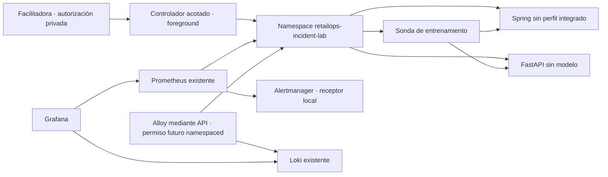

# F5.5 — Laboratorio de incidentes SRE

Fecha: 2026-11-17, America/Guayaquil. **Solo F5.5-A preparada y validada. Ningún incidente ejecutado.** F5.4 y GitHub Actions verde confirmados por el usuario. F5.5-B requiere autorización posterior; no se avanza a otra fase.

## Dos etapas y alcance

**F5.5-A (esta entrega):** código, chart, catálogo, plantillas, integración opcional de observabilidad, unitarias con mocks/fixtures, validadores offline y preflight de solo lectura. No se aplica namespace/chart/RBAC, no se escalan workloads, no se cambia lab_active y no se arrancan servicios. Las métricas de fixtures de promtool no son incidentes ni mediciones reales.

**F5.5-B (pendiente):** preparación operativa autorizada del baseline y después autorización explícita por ejercicio. Estado, aprobación consumida, causa elegida, guía de evaluación, cronología, logs, evidencias y postmortem se guardan únicamente en rutas ignoradas. No hay comando que genere una autorización válida automáticamente.

El preflight actual informa backup autenticado/validado, nodo Ready, margen RAM y fuentes cerradas; `ready_for_execution=false` porque el namespace de entrenamiento todavía no está provisionado. Es el resultado esperado de A, no un despliegue saludable ni una validación end-to-end. La preparación técnica no autoriza a ejecutar el primer escenario.

## Arquitectura y dependencias



Chart `infra/helm/retailops-incident-lab`, namespace y release obligatoriamente `retailops-incident-lab`. Tres Deployments/ClusterIP: `spring`, `ml`, `gateway`. Reutiliza imágenes app F5.2 ya identificadas y Python por digest; `imagePullPolicy=Never`, sin nuevas importaciones/descargas automáticas. Si falta una imagen, no está listo: inspeccionar inventario y solicitar procedimiento autorizado, no reinstalar/importar sin necesidad.

Spring arranca **sin perfil integrado**, solo proceso/Actuator, sin SQL/Airflow. FastAPI expone salud de proceso **sin ML_MODEL_VERSION**, sin modelo/caché/credencial/trainer; `/model` no representa un candidato cargado. Esto no es recuperación de la aplicación comercial ni ensayo de inferencia. El candidato v1 y el cutoff originales no participan ni se modifican.

Gateway stdlib solo admite destinos internos fijos `http://spring:8080/actuator/health` y `http://ml:8000/health`. Probes secuenciales cada 5s, tres componentes (incluye marcador de almacenamiento propio); máximo dos probes simultáneos y cuatro handlers HTTP, timeout acotado. No generador de carga parametrizable ni URLs arbitrarias. Métricas HTTP reales de la sonda, RSS propio y reserva controlada; logs JSON sin URL/query/payload/IP/credenciales, request_id solo como campo.

Namespace restricted, SA sin token, UID/GID1000, raíz RO, capabilities drop ALL y seccomp. **Sin PVC, Secrets, datos, modelos, Docker socket, hostPath, host networking o permisos API desde los pods.** Solo emptyDir y ConfigMaps propios. Políticas deny ingress/egress por defecto: permiten DNS CoreDNS, gateway→réplicas y Prometheus→métricas. No existe camino permitido hacia Compose, MLflow original, PostgreSQL, MinIO, Internet o servicios de negocio.

Presupuesto: requests totales 225m/288MiB, límites 1100m/896MiB; quota namespace tres pods, requests300m/384MiB, limits1500m/1GiB y **cero PVC**. Recreate evita surge; memoria gateway128MiB, reserva máxima fija48MiB y marker emptyDir1MiB. No se ensaya OOM ni se alteran límites del MLflow conservado. Preflight exige ≥4GiB RAM disponible; controlador revierte si observa <2GiB. No garantiza capacidad frente a cargas ajenas no controladas ni aislamiento de un administrador del nodo.

## Catálogo versionado

Todos los escenarios requieren: autorización B vigente individual ligada a entorno/hash/backup, preflight listo, baseline saludable y sin otro ejercicio, fuentes cerradas y observabilidad propia disponible. Duración máxima **600s**, sin parámetros de carga arbitrarios. Catálogo completo en `infra/incident-lab/scenarios.json`.

| ID | Objetivo y mecanismo exclusivamente de laboratorio | Evidencia esperada | Recuperación/reversión | Riesgos y límites |
| --- | --- | --- | --- | --- |
| IL-001 | Investigar indisponibilidad Spring; escalar solo `deployment/spring` a cero | Target incident-spring DOWN, probes503 y alerta propia | Restaurar réplica1, rollout y cinco probes200 | Solo proceso réplica, sin caída de API comercial/SQL |
| IL-002 | Investigar 5xx; gateway devuelve503 en `/spring-health` | Contador HTTP/JSON y ratio5xx de sonda | Estado normal, cinco probes200 y ventana estable | No modifica lógica Spring ni genera errores reales de negocio |
| IL-003 | Investigar latencia; gateway retrasa1.5s en `/spring-health` | Histograma/p95 de sonda >1s; HTTP200 | Estado normal, cinco probes rápidos y decaimiento de ventana | Probes limitados, no benchmark/carga masiva |
| IL-004 | Investigar ML inaccesible; cambiar selector gateway en `NetworkPolicy/ml-ingress` | ML pod/scrape UP, gateway→ML503/timeout | Restaurar política exacta capturada y cinco probes200 | Solo red entre réplicas, no inferencia; no tocar UFW |
| IL-005 | Observar presión acotada; reservar48MiB una sola vez en gateway | Gauge reserva>32MiB, RSS propio y alerta | Liberar reserva al volver a normal; RSS puede retener páginas | No stress-ng/OOM/host memory, no workers o límites originales |
| IL-006 | Investigar fallo de lectura; retener temporalmente marcador emptyDir | storage503 y tipo FileNotFoundError en log propio | Reponer marcador con mismos bytes y cinco probes200 | No falla PVC/MinIO/PG ni restaura backups sobre origen; no desastre integral |

El catálogo describe posibilidades, no anuncia el escenario elegido. Fallos locales de sonda están identificados como entrenamiento: no se presentan como errores reales de Spring, inferencia o datos. La observabilidad separa `scope=exercise`, `environment=incident-lab` y jobs `incident-*` de F5.3 operativa y validación sintética anterior.

## Observabilidad opcional, deshabilitada por defecto

`incidentLab.enabled=false` en ambos charts existentes preserva la configuración actual. Activarlo posteriormente añade:

- Prometheus: tres scrape jobs, cinco reglas `IncidentTraining*` y dashboard `retailops-incident-training` con seis paneles. Ventanas/for conservadores, mínimo diez probes para ratios/p95. Alertmanager conserva solo su receptor local; ninguna notificación externa.
- Alloy: descubrimiento del namespace y contenedores spring-replica/ml-replica/gateway, label environment=incident-lab y el mismo filtro de eventos HTTP seguros. Role/Binding **adicional exclusivamente en el namespace nuevo**: get/list/watch pods y get pods/log para la SA ya existente. No se concede/applica ese permiso en A; debe revisarse y autorizarse con la preparación B. No Secrets, exec, nodes/proxy o escritura.

El indicador `incident_lab_watch_enabled` señala sesión sin cerrar, no causa ni garantía de incidente. Las reglas propias se habilitan solo durante esa sesión. `cleanup` exige observar watch=0 en Prometheus antes de escalar réplicas a cero para evitar falsas alertas de cierre. No habilitar F5.3 lab_active de negocio: las fuentes continúan cerradas, no deben alarmar por apagado intencional.

## Comandos disponibles

Usar Python3.12 del proyecto uv, herramientas/kubeconfig F4 y paths privados conocidos. **En A solo list, status, preflight y validadores estáticos.**

```bash
export UV_PYTHON_INSTALL_DIR="$PWD/.local/python"
scripts/validate_incident_lab.sh
uv run --project apps/ml-service --locked python scripts/incident_lab.py list
uv run --project apps/ml-service --locked python scripts/incident_lab.py status
uv run --project apps/ml-service --locked python scripts/incident_lab.py preflight \
  --backup /home/diego/Backups/retailops/backup-20261117T161854Z-375a34c472b3 \
  --key /home/diego/Backups/retailops-keys/20261117T161854Z-375a34c472b3.key \
  --recovery-report /home/diego/Backups/retailops-restores/restore-07/restore-report.json
```

Preflight no descifra backup, no crea copia, no restaura datos ni cambia servicios. Verifica SHA/MAC y relación del informe F5.4 validado/v1 con el mismo backup; antigüedad ≤24h. Leer una copia local autenticada no demuestra offsite/host recovery. Si está vencido, renovar manualmente según BACKUP_RECOVERY con quiescencia, nunca automáticamente desde esta herramienta.

| Comando | Comportamiento |
| --- | --- |
| preflight | Validación/config y lecturas de backups/K3s/Docker/observabilidad. Sin `--require-ready`, informa bloqueos sin ejecutar nada |
| list | Catálogo público de ID/título/objetivo; no causa activa |
| start | Solo futuro B, autorización privada y preflight vivo listo; ejecuta un escenario y permanece foreground vigilando deadline/RAM |
| status | Solo ID opaco, fase y deadline; nunca escenario, baseline o evaluación privada |
| stop | Reversión de campos propios por UID/propietario; idempotente y permitida tras expirar aprobación para recuperar |
| verify | Preflight estricto: debe comprobar baseline, probes saludables/ventana y telemetría; exit2 si no listo |
| cleanup | stop + esperar watch0 + escalar solo las tres réplicas propias a cero; no delete, Helm uninstall, PVC/volúmenes/backup/estado/evidencias eliminados |

No aceptar errores de `verify` como recuperación. Con latencia/5xx históricos, esperar la ventana necesaria y registrar estabilización separada del tiempo de reversión. Cleanup repetido tras fase cleaned y stop repetido no reinyectan ni borran evidencia.

## Preparación operativa futura — F5.5-B, NO ejecutada

**No ejecutar este apartado durante A.** Requiere autorización posterior para provisionar baseline/observadores, incluido el Role de logs nuevo. Revisar imágenes ya presentes, snapshot original y RAM. Mantener PostgreSQL/MinIO/MLflow/Airflow/apps originales cerrados. No usar scripts que arranquen dependencias de negocio.

Con autorización de preparación B y contexto/kubeconfig explícitos: aplicar únicamente `infra/incident-lab/namespace.yaml`, instalar chart `retailops-incident-lab` en ese namespace y activar flags incidentLab en releases conservadas de observabilidad/logs, reutilizando sus PVC/credenciales. No reinstalar K3s, generar secretos/importar imágenes innecesariamente o tocar UFW. Helm/no Secrets reales en charts. Los comandos concretos para la operadora, solo después de esa aprobación:

```bash
# SOLO F5.5-B autorizada; no ejecutado en esta entrega.
export PATH="$PWD/.local/f4/tools:$PATH"
export KUBECONFIG="$PWD/.local/f4/kubeconfig"
export KUBE_CONTEXT=default
kubectl --context "$KUBE_CONTEXT" apply -f infra/incident-lab/namespace.yaml
helm --kube-context "$KUBE_CONTEXT" upgrade --install retailops-incident-lab \
  infra/helm/retailops-incident-lab -n retailops-incident-lab --wait --timeout 5m
helm --kube-context "$KUBE_CONTEXT" -n retailops-observability upgrade retailops-observability \
  infra/helm/retailops-observability --set logging.enabled=true --set alerting.enabled=true \
  --set incidentLab.enabled=true --wait --timeout 5m
helm --kube-context "$KUBE_CONTEXT" -n retailops-observability upgrade retailops-logging \
  infra/helm/retailops-logging --set collectionAuthorized=true --set replicas=1 \
  --set incidentLab.enabled=true --wait --timeout 5m
```

Forwards en terminales dedicadas, exclusivamente loopback: `scripts/observability.sh prometheus`, `scripts/observability.sh grafana`, `scripts/sre.sh alertmanager`. No abrir LAN ni usar host networking. Los permisos efectivos y aislamiento/red/logs de este namespace deben verificarse en B antes de aprobar un ejercicio: el render/validator A no los certifica. `preflight --require-ready` y `verify` exigen además probes200 por componente, targets/reglas y logs propios; no usan datos o logs del origen para aparentar disponibilidad.

## Autorización individual y ejecución futura

`infra/incident-lab/authorization.example.json` es **deliberadamente inválido** (stageA, consentimiento inválido, IDs placeholder y tiempos cero). No es un permiso. Solo después de autorización explícita posterior para un escenario concreto, la facilitadora crea manualmente `.local/f55/facilitator/approval.json`, 0600, directorio0700:

- stage F5.5-B, action start, consentimiento literal `I_AUTHORIZE_F5.5_B_ONE_SCENARIO`.
- escenario autorizado y UUID opaco nuevo de32 hex, issued_at/expires_at Unix UTC (máximo15min).
- namespace_uid/cluster_server/backup_id del preflight listo; `catalog_sha256` corresponde al bundle versionado actual (catálogo, controlador, charts/overlays/runtime), no a un estado temporal.
- approved_by y approval_reference de la autorización real. No inventar ni preaprobar una sesión durante A.

Consultar hash actual sin iniciar nada: importar `scripts/incident_lab.py` y llamar `c.catalog_hash()`; el fichero no requiere credencial adicional ni se genera automáticamente. Preflight y hash se registran en la guía privada de la facilitadora; no mostrar el escenario elegido al investigador.

La autorización es una declaración local operadora, no firma criptográfica de mensajes de chat ni barrera contra quien ya administra el clúster/repo. Guardas reducen errores accidentales: contexto local default, cluster/namespace UID/backup/bundle ligados, TTL, fichero privado y ledger de IDs consumidos. Cambios de código requieren nueva aprobación; no se permite replay de ID detenido/limpiado. No crear ese archivo válido en esta tarea.

Sintaxis preparada **solo para B**, con escenario/archivo elegidos privadamente y los mismos flags backup/key/report:

```text
incident_lab.py start --scenario <ID autorizado> --authorization .local/f55/facilitator/approval.json --backup <backup> --key <clave> --recovery-report <informe>
incident_lab.py stop
incident_lab.py verify --backup <backup> --key <clave> --recovery-report <informe>
incident_lab.py cleanup
```

Start corre foreground en terminal facilitadora; el investigador usa otra terminal. Ctrl-C ejecuta finally/reversión antes de salir; si el proceso muere, **no se garantiza reversión de escala/política** porque ningún pod recibe permisos Kube. Estados locales de sonda expiran y liberan memoria/reponen marcador, pero hay que ejecutar stop/verify para recuperar Spring/política y cerrar sesión. TTL no equivale a recuperación comprobada.

Stop verifica UID original del objeto, namespace, labels y cluster; usa test de resourceVersion en JSONPatch y no sobrescribe políticas/replicas/control modificados por terceros. Ante deriva concurrente, se detiene para revisión en vez de forzar cambios. Cleanup conserva namespace/release/estado; para rearmar otra sesión hace falta preparación B revisada, no usar un authfile antiguo.

<a id="investigacion"></a>

## Investigación sin revelación automática

El investigador recibe ID opaco y ventana UTC. Puede usar kubectl get/describe/logs/top, Helm status/get/history, métricas, Grafana, Loki/Alertmanager y RUNBOOKS. Los comandos públicos no cargan/muestran la guía, ID de escenario activo, patch o baseline. Un administrador puede inspeccionar ConfigMaps/recursos/código y deducir el mecanismo; esto es separación operativa de roles, no secreto frente al cluster-admin. El catálogo público describe todos los escenarios, no el seleccionado.

```bash
kubectl --context default -n retailops-incident-lab get pods,deployments,services,networkpolicies
kubectl --context default -n retailops-incident-lab describe pod <pod observado>
kubectl --context default -n retailops-incident-lab logs <pod> --tail=100
kubectl --context default -n retailops-incident-lab top pods
helm --kube-context default -n retailops-incident-lab status retailops-incident-lab
```

PromQL: `up{scope="exercise"}`, `ALERTS{scope="exercise"}`, `sum by(component,status)(rate(incident_lab_requests_total[2m]))`, `histogram_quantile(0.95,sum by(component,le)(rate(incident_lab_request_seconds_bucket[2m])))`, RSS/reserva de sonda. LogQL: `{namespace="retailops-incident-lab",environment="incident-lab"} | json`, filtrar status o request_id real. No request_id/usuarios/rutas como etiquetas. Las probes no propagan una traza end-to-end entre las réplicas: no inventar correlación inexistente.

La guía real se genera solo en B: `.local/f55/facilitator/exercises/<id>/evaluation.md`, junto al estado privado y snapshots. No se abre desde status/list/verify ni se adjunta a prompts del investigador. Git contiene solo la **plantilla** de rúbrica con placeholders; evidencias/respuestas seleccionadas nunca. Evaluación posterior: 0–2 puntos para seis criterios (síntomas/alcance, hipótesis, correlación de evidencia, diagnóstico, recuperación segura, postmortem), máximo12; no penalizar al operador por telemetría no provisionada, invalidar el ejercicio.

## Plantilla de postmortem — guardar en ruta ignorada durante B

```text
ID opaco / fecha UTC / facilitadora / investigador:
Alcance autorizado y recursos de entrenamiento:
Impacto observado (separar fuente original, réplica y sonda):
Cronología: inicio, detección, hipótesis, diagnóstico, reversión, estabilización:
Evidencia: consultas/ventanas/UIDs/logs/request_id; enlaces locales privados:
Hipótesis descartadas y causa raíz demostrada:
Recuperación aplicada y verificación; no confundir expiración con recuperación:
Integridad/fuentes/PVC/backup/credenciales conservados:
Qué faltó o no se pudo medir; tiempos y límites:
Acciones preventivas concretas, responsable y revisión propuesta:
Evaluación facilitadora posterior (adjuntar guía solo al terminar):
```

## Archivos y Git

**Versionables A:** chart y namespace, controlador/sonda/catálogo, ejemplo inválido de autorización, plantilla evaluadora, tests unitarios/promtool, validación/CI, overlays opt-in y esta documentación/progreso/roadmap/decisiones. No contienen incidente activo o guía seleccionada.

Inventario para revisión/staging manual posterior (sin staging en esta tarea):

- `infra/incident-lab/`: catálogo, controlador, namespace, ejemplo inválido, plantilla y tests.
- `infra/helm/retailops-incident-lab/`: chart, sonda y configuración completa.
- `infra/helm/retailops-observability/{values.yaml,templates/config.yaml,files/incident-lab/}` y `infra/helm/retailops-logging/{.helmignore,values.yaml,templates/rbac.yaml,templates/workloads.yaml,files/incident-lab/}`.
- `scripts/incident_lab.py`, `scripts/validate_incident_lab.sh`, `.github/workflows/ci.yml`.
- `AGENTS.md`, `README.md`, `docs/{INCIDENT_LAB,PROGRESS,ROADMAP,ARCHITECTURE,DECISIONS,DEPLOYMENT,SRE,RUNBOOKS,LOGGING,BACKUP_RECOVERY}.md`.

**Ignorados:** `.local/f55/**` completo (aprobaciones, ledger, estado/snapshots, guías reales, cronología, métricas/logs/screenshots/postmortem) y `.local/f55-a/**` (evidencia de validación A). Ya cubiertos por `.local/` en .gitignore. Backups/claves/restores F5.4 continúan fuera de Git. Nunca add -f, commit/push de evidencias, secretos, .env o modelos. Cleanup no elimina esos archivos ni backups. No usar nombres/path que revelen escenario activo al investigador.

## Validación realizada y pendiente

Solo A: unitarias con FakeBackend y directorios temporales, fixtureHTTP sin servidor/red/carga/memoria real, fixtures PromQL y validadores Helm/kubeconform/promtool/Alloy; preflight real de **solo lectura** contra laboratorio cerrado. Las pruebas de start/stop son mocks, no ejecuciones de incidentes. Configuración anterior con flags false contrastada por render; namespace no provisionado, causas/guías seleccionadas no creadas y servicios no arrancados.

Pendiente para B: autorización, provisionamiento seguro, imágenes/PodSecurity/NetworkPolicies/RBAC efectivos, observadores/targets/logs y salud real de réplicas, ejercicio individual y postmortem. No afirmar alertas disparadas, carga/latencia/memoria de las réplicas o recuperación real de un escenario. CI F5.5-A añadida y validada solo localmente, sin commit/push/pull/GHCR.

Fuentes primarias: [NetworkPolicy y selectores](https://kubernetes.io/docs/concepts/services-networking/network-policies/), [scrape estático y etiquetas](https://prometheus.io/docs/prometheus/latest/configuration/configuration/). Los resultados de A proceden de sus pruebas locales, no de incidentes ejecutados.
