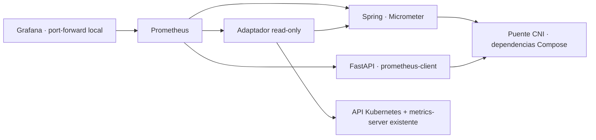

# F5.1 — Prometheus y Grafana del laboratorio híbrido

Implementada y validada realmente el 2026-11-16, America/Guayaquil. Exclusivamente métricas: sin Loki, Alertmanager, reglas de alerta, backups o simulaciones de incidentes. CI RetailOps #2 de F4 fue exitoso según confirmación del usuario; la ampliación CI de F5.1 está validada localmente y aún no se ejecutó en GitHub.

## Arquitectura

- Spring conserva salud y añade Micrometer Prometheus, `/actuator/prometheus`, métricas JVM/HTTP e histogramas con buckets 10 ms…5 s. Exportación explícita; ningún endpoint env/config adicional.
- FastAPI añade prometheus-client **0.26.0**, bloqueado por uv, con `/metrics`, counters/histogramas HTTP y métricas de proceso/modelo. Registro por aplicación, etiquetas método/ruta normalizada/status. URLs desconocidas comparten unmatched; sin parámetros, features, tienda/familia, credenciales o respuestas como etiquetas. `/metrics` no se cuenta a sí mismo.
- Chart separado `infra/helm/retailops-observability`: Prometheus **3.16.0**, Grafana **13.3.1** y adaptador Python 3.12 stdlib. Imágenes por digest en values/images.lock. Tres Deployments de una réplica, ClusterIP, seccomp, UID no root, capacidades eliminadas y filesystem raíz de solo lectura. Namespace nuevo con Pod Security restricted. Sin operadores, hostPath, socket Docker, contenedores privilegiados o agentes del host.
- El adaptador **reutiliza metrics-server existente**, lee pods/deployments/nodos y consumo Kubernetes, y convierte esas observaciones a texto Prometheus. No instala otro metrics-server, node-exporter, kube-state-metrics o cAdvisor. Su ServiceAccount solo tiene get/list de nodos y get/list de pods/deployments/metrics pods en retailops y retailops-observability. Verificados los rechazos de Secrets, pods/exec y nodes/proxy; Prometheus y Grafana no montan token Kubernetes.
- Disponibilidad de dependencias: el adaptador consulta Spring `/v1/platform`, que realiza SQL read-only y probes HTTP existentes. No entrega secretos SQL/S3 al adaptador ni añade exporters administrativos. PostgreSQL UP significa consulta SQL publicada; los otros UP son respuesta HTTP de salud, no prueba exhaustiva de funcionamiento. Modelo cargado se mide separadamente en FastAPI.



## Red y seguridad

Se conservan UFW, interfaz, rutas y puente F4: pods 10.42/16, servicios 10.43/16 y puente 10.42.0.1 a puertos ya aprobados. No hay nuevos puertos del host fuera de port-forward loopback. No se modificó UFW, se reinstaló K3s o se publicó una imagen.

`observability.enabled` del chart app añade ingreso desde Prometheus/adaptador del namespace de observabilidad, identificado por namespaceSelector y podSelector. Se conserva la cadena web→Spring→ML. nginx bloquea `/api/actuator/prometheus` con 404 para no publicarlo vía frontend; las métricas se scrapean directamente en servicios internos. La política no filtra rutas HTTP: el pod web conserva su acceso de negocio a Spring en 8080, parte de la confianza local. No es autenticación comercial/multiusuario.

En observabilidad, Prometheus solo admite entrada de Grafana; adaptador solo de Prometheus; Grafana no admite entrada ordinaria de pods. El port-forward del administrador permite acceso local. Probado: DNS Prometheus resuelve desde ML, pero su conexión no autorizada se rechaza; el canal Grafana autorizado consulta las mismas series correctamente. Grafana devuelve 401 a API anónima. No hay admin API/write remoto Prometheus habilitado ni agentes de alertas. Unified alerting Grafana desactivado.

Grafana usa Secret externo `retailops-grafana-admin`, creado desde archivos 0600 en `.local/f51/grafana-admin-{user,password}`. Password aleatorio y conservado; el helper no rota ni sobrescribe secretos existentes. Nunca imprimir credenciales o kubeconfig en logs/Git. No modificar permisos globales; `.local/f4/kubeconfig` sigue privado, contexto default. Solo el usuario importó una vez las nuevas imágenes app con k3s ctr; no fue necesario otro sudo.

## Persistencia y retención

Namespace y PVC externos a Helm en `infra/observability/storage.yaml`: Prometheus 2 GiB y Grafana 1 GiB local-path/RWO, ambos Bound. No comparten almacenamiento con datasets/modelos o bases Compose. Prometheus retiene **48 h / 512 MiB de bloques**, comprobado en flags reales como 2d/512MiB. WAL/head añaden espacio temporal: no confundir esa retención con un límite exacto del directorio. Sin reglas de recording/alerting desplegadas. El archivo temporal de reglas usado por promtool solo valida sintaxis de consultas.

Grafana conserva SQLite/configuración propia en su PVC; datasource y tres dashboards JSON se provisionan por ConfigMaps versionadas. dashboards no editables, datasource UID retailops-prometheus y proveedor sin borrado automático. Al detener se escalan workloads a cero; no eliminar PVC, namespace, Secret, release ni datos. Los permisos y objetos read-only RBAC permanecen para reactivación.

## Métricas y dashboards

| Serie / familia | Observación y límites |
| --- | --- |
| up | Éxito del scrape de cada target; no equivale a estado de negocio |
| http_server_requests_seconds_{count,sum,bucket} | HTTP Spring por plantilla URI/status; buckets SLO, p95 aproximado |
| retailops_ml_http_requests_total | Solicitudes FastAPI completadas, incluidas validaciones 4xx |
| retailops_ml_http_request_duration_seconds_* | Duración HTTP FastAPI; no es un benchmark exclusivo del algoritmo |
| retailops_ml_model_loaded | Runtime realmente presente, 1/0; no aprobación de producción |
| retailops_ml_model_info | Nombre, versión, contrato y propósito del runtime cargado |
| process_resident_memory_bytes / process_cpu_seconds_total | Proceso del endpoint correspondiente; no toda la memoria del contenedor |
| retailops_kubernetes_node_ready / *_pod_ready | Condiciones observadas en API Kubernetes |
| retailops_kubernetes_deployment_{desired,available}_replicas | Escala y disponibilidad reales; cero deseado no es automáticamente un incidente |
| retailops_kubernetes_container_cpu_cores | Uso de CPU desde metrics-server, en cores |
| retailops_kubernetes_container_memory_working_set_bytes | Uso working set desde metrics-server; no suma de RSS de procesos |
| *_cpu_{requests,limits}_cores / *_memory_{requests,limits}_bytes | Configuración de recursos observada en los pods |
| retailops_dependency_up | Resultado SQL/HTTP de las probes existentes, con etiqueta probe explícita |
| retailops_collector_section_success | Si la sección se pudo consultar; no inventa estados de dependencias desconocidas |

Dashboards versionados en `infra/helm/retailops-observability/files/dashboards`:

1. **Disponibilidad y modelo:** cuatro targets, cinco dependencias, nodo, réplicas deseadas/disponibles, consultas del adaptador y candidato cargado.
2. **Solicitudes, errores y latencia:** tasas HTTP, 4xx/5xx y p95 Spring/FastAPI por ruta.
3. **Recursos:** CPU/memoria de los dos namespaces, requests/limits y procesos instrumentados.

No se exportan continuamente CPU/memoria de contenedores Docker/MLflow: se conservan snapshots operativos y probes sin montar su socket o cgroups del host. Airflow UP corresponde a su API; scheduler/processor siguen detenidos.

Veintidós expresiones PromQL, sin valores sintéticos ni fallback «or vector(0)». Una serie no observada muestra No data; p95/rate requieren ventana y varias muestras. Valores de fixtures solo se usan en tests, nunca se cargan en Prometheus/Grafana como medición real.

## Investigación MLflow y presupuesto

F4 registró ~994 MiB de límite 1 GiB. Antes de decidir ajustes se comprobó que todo estaba detenido; después se reactivó MLflow normalmente con las dependencias necesarias. **No se reinició para experimentar ni se cambió límite, workers, imagen, datos o configuración del servicio.**

`scripts/inspect_mlflow_memory.py` lee exclusivamente memory.stat/current/max/swap.current y smaps_rollup de procesos del contenedor ya activo; no lee argumentos o entorno que puedan incluir DSN. Evidencia inicial: anon ~991.5 MiB, file ~0.7 MiB, kernel ~21.5 MiB, memory.current ~1017.3 MiB y swap ~927.2 MiB. Segunda muestra: anon ~980.6 MiB, file ~8 MiB y swap ~972.4 MiB. Se observaron varios procesos Python y PSS, con la propia inspección incluida. **Predomina memoria anónima de procesos, no caché de archivos**; las mediciones no identifican por sí solas la función de cada worker ni son un perfil exhaustivo de heap.

MemoryMax se conserva en 1 GiB y MemorySwap Docker en 2 GiB combinado RAM+swap; no hubo OOM/reinicios MLflow. La presión de RAM/swap existente es un riesgo operativo real: no afirmar que el límite es holgado o que subirlo resolvería la causa. Cualquier ajuste futuro de procesos/límites requiere revisión separada; esta entrega no aplica uno. Host con ~18–20 GiB disponibles durante las observaciones, sin presión global que justifique ampliar indiscriminadamente límites.

| Componente nuevo | Requests CPU / memoria | Limits CPU / memoria | Muestra real |
| --- | --- | --- | --- |
| Prometheus | 100m / 128 MiB | 500m / 384 MiB | ~41 MiB, 1m CPU |
| Grafana | 100m / 256 MiB | 1 / 512 MiB | ~326 MiB, 3m CPU |
| Adaptador | 25m / 32 MiB | 100m / 64 MiB | ~16 MiB, 1m CPU |
| Total | 225m / 416 MiB | 1.6 / 960 MiB | ~383 MiB, 5m CPU |

Muestras, no picos ni capacidad productiva. Grafana inicialmente se estimó con límite 256 MiB y sufrió OOMKilled durante el arranque; se corrigió a 512 MiB con evidencia y el [mínimo de evaluación oficial](https://grafana.com/docs/grafana/latest/setup-grafana/installation/), request 256 MiB y GOMEMLIMIT 384MiB. El pod final se estabilizó; no se ocultó el fallo ni se aplicó el cambio a MLflow. No se realizaron pruebas de estrés o incidentes. Grafana usa más que su request: revisar presupuestos si se suman cargas al nodo.

## Iniciar y consultar

Requiere el K3s existente activo/Ready, herramientas F4 y tres imágenes instrumentadas ya importadas. No ejecutar bootstrap, prepare-host.py/install.sh ni repetir UFW. Etiqueta de la validación: `sha-f4fc9b2785b4adf4263b40b33d75e6f3e0b6eaa5`; imágenes F4 permanecen sin sobrescribir. La base MLflow está congelada; Dockerfile.ml instala únicamente dependencias app desde ml-requirements.lock con hashes.

```bash
export PATH="$PWD/.local/f4/tools:$PATH"
export KUBECONFIG="$PWD/.local/f4/kubeconfig"
export KUBE_CONTEXT=default
export VALUES_FILE="$PWD/.local/f51/values-app.yaml"
scripts/validate_observability.sh
scripts/observability.sh start
# Terminal separada, mantener activa durante el laboratorio:
python scripts/compose_bridge.py
# Otra terminal con las mismas variables:
scripts/observability.sh deploy-app
scripts/observability.sh status
```

start reutiliza recursos/credenciales y no importa imágenes. Si falta el inventario esperado se detiene: construir imágenes nuevas mediante build_observability_apps.sh y solicitar al usuario la importación exacta, sin publicar registros ni eludir sudo. El archivo privado de values mantiene endpoints/aliases/secretos por referencia y habilita observability.enabled. Si se pierde la configuración privada, partir de infra/k3s/values-compose.yaml.example con la etiqueta explícita y observability.enabled=true; conservar Secret/PVC existentes.

Acceso en terminales dedicadas:

```bash
scripts/observability.sh prometheus # http://127.0.0.1:9091
scripts/observability.sh grafana    # http://127.0.0.1:3001
scripts/deploy.sh forward          # http://127.0.0.1:5174
# Con esos forwards activos:
python scripts/smoke_deployment.py
scripts/observability.sh verify
python scripts/inspect_mlflow_memory.py # Solo si MLflow ya está activo.
```

Usar las credenciales privadas de Grafana en la terminal/navegador local, nunca compartirlas. Un upgrade que sustituya pods puede cerrar forwards: volver a abrir únicamente los propios. No hay auto-restart de forwards o servicios ajenos. El helper stop presupone que las dependencias fueron iniciadas para este laboratorio; no usarlo sobre servicios ajenos en uso.

## Pruebas ejecutadas

**Estáticas/locales:** Maven verify, 10 pruebas; uv locked pytest, 13 pruebas (fixtures sintéticas, sin entrenamiento/registro reales); tres unittest del adaptador; tres imágenes app nuevas construidas sin publicación. Helm lint/render, kubeconform 34 recursos válidos sin skips, promtool config y 22 expresiones de dashboards válidas; actionlint, bash -n, py_compile y diff --check. No se repitió build/lint React: no cambiaron sus fuentes, solo configuración nginx, verificada por HTTP con imagen nueva. CI añade validate_observability.sh; esta versión del workflow no se ejecutó remotamente todavía.

**Reales en K3s:** usuario importó una vez imágenes nuevas y se verificó inventario; tres apps Ready y tres componentes observabilidad Ready, tres PVC Bound. Cuatro targets **spring/fastapi/lab/prometheus UP**; Grafana datasource OK y consulta proxy devuelve nodo real; tres dashboards/UID/títulos/leyendas/22 expresiones coinciden con archivos; 24 consultas ejecutadas. Cinco dependencias observadas UP (PostgreSQL SQL, FastAPI/MLflow/MinIO/Airflow HTTP). Modelo real retailops-sales-global v1/sales-pit-v1/candidate_local_preview cargado y gauge 1.

Smoke funcional F4 sigue pasando. Se observó contador Spring 400=1 por consulta fuera de corte y contador FastAPI 422=1 por cuerpo inválido, sin ejecutar inferencia o alterar dependencias. Medición de ventana de prueba: Spring ~0.367 req/s/p95 ~0.028 s; FastAPI ~0.333 req/s/p95 ~0.0095 s. Incluye probes y, en la consulta agregada Spring, scrapes; no es benchmark de tráfico comercial. Prometheus mostró ~1334 series head en una muestra. Frontend no expone métricas (404); Grafana API rechaza anónimo (401); cliente app no autorizado a Prometheus rechazado aunque su DNS resuelve; RBAC negativo verificado. No hay prueba visual de navegador ni evaluación de disponibilidad bajo fallos.

**Integridad:** snapshots SQL read-only antes/después idénticos: 1 297 296 ventas, suma decimal/fechas, 9 106 020 features, cutoff 2014-12-31, cero autorizaciones nuevas/etiquetas futuras. Registro/métricas v1 y 19 versiones de objetos MLflow iguales; cuatro volúmenes Compose conservan identidad/configuración. No hash exhaustivo de todas las tablas ni prueba de backup/restore.

**Problemas corregidos:** primera prueba Spring daba 404 por exportación desactivada en tests; exportación explícita y verificación real resolvieron. Grafana OOM inicial corregido con presupuesto medido. Adaptador etiquetaba erróneamente consumo del namespace de observabilidad como retailops; consulta real lo detectó, se corrigió y añadió regresión. Las muestras antiguas de la TSDB previas a esa corrección conservan la etiqueta errónea; acotar análisis a la fase validada, sin purgar ni presentar ese tramo como resultado correcto. La prueba inicial de rechazo esperaba timeout, pero K3s devuelve ConnectionRefused: se contrastó rechazo con acceso Grafana autorizado, sin cambiar políticas.

Evidencia privada `.local/f51`: maven/pytest/static-validation-final, helm-*, verification-*.json/logs, verified-series/http-series, rbac-verified, network-deny, prometheus-flags, resources-*, mlflow-memory*, data-before/data-after/data-comparison y volumes-comparison. Estado final de cierre se registra por separado; ningún secreto, dataset, modelo, tar, kubeconfig o log se añade a Git.

## Detener conservando estado

```bash
scripts/observability.sh stop
# Ctrl-C en los forwards y puente de esta sesión.
```

Escala apps y observabilidad a cero, espera terminación de pods y detiene solo las cuatro dependencias del laboratorio. Conserva Prometheus/Grafana y caché ML en sus PVC, Secrets, RBAC, namespaces, releases e imágenes. K3s ya estaba activo y se conserva activo/disabled. Nunca down -v/prune/uninstall, borrados de PVC/namespace, regeneración de secretos o migraciones destructivas. No avanzar a F5.2.

Referencias primarias de diseño: [Micrometer/Actuator](https://docs.spring.io/spring-boot/reference/actuator/metrics.html), [cliente Python](https://prometheus.github.io/client_python/exporting/http/asgi/), [provisión Grafana](https://grafana.com/docs/grafana/latest/administration/provisioning/), [riesgo de nodes/proxy](https://kubernetes.io/docs/concepts/security/api-server-bypass-risks/). Los resultados y cifras anteriores proceden del laboratorio, no de esas páginas.

Cierre real comprobado: seis Deployments (tres app y tres observabilidad) a cero, sin pods en ambos namespaces; tres PVC Bound y releases/Secrets conservados. PostgreSQL/MinIO/MLflow/Airflow API exited(0), sin OOM/reinicios de esas dependencias; puente y tres forwards cerrados y sin listeners temporales. K3s permanece Ready, activo y disabled. Evidencias closure.json, app-stopped.json y observability-stopped.json.
